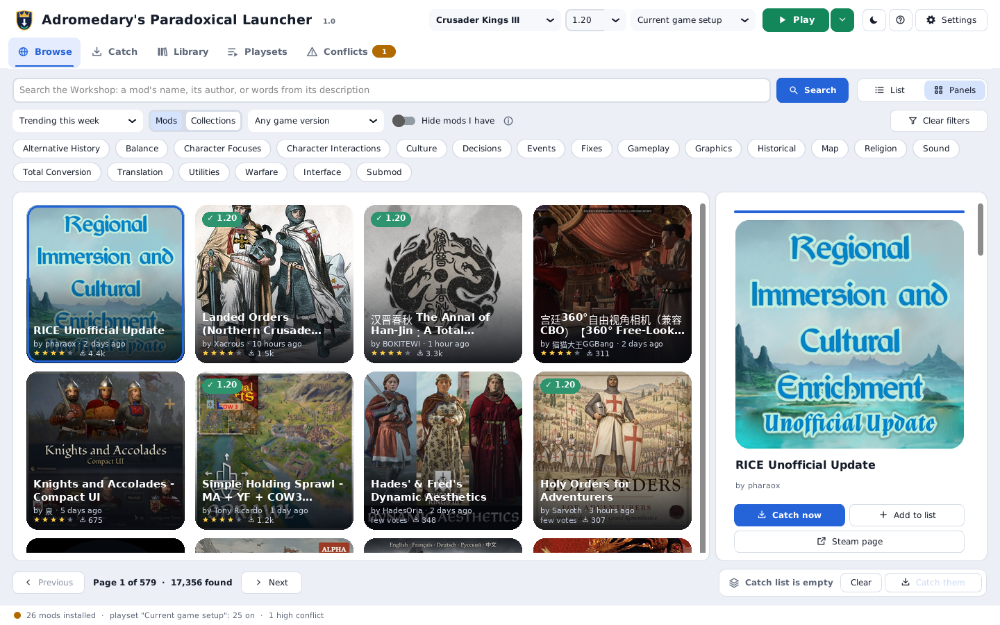
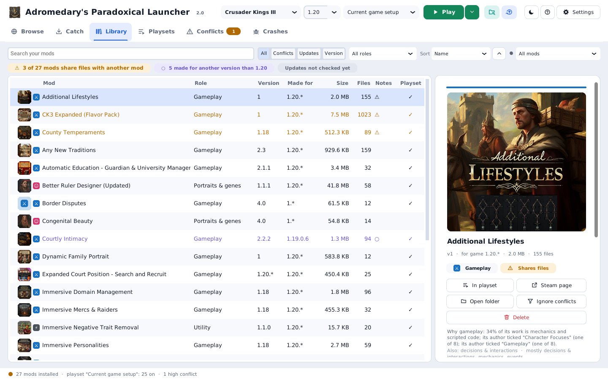
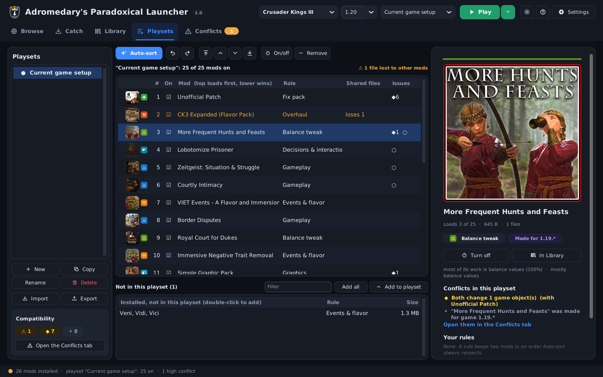
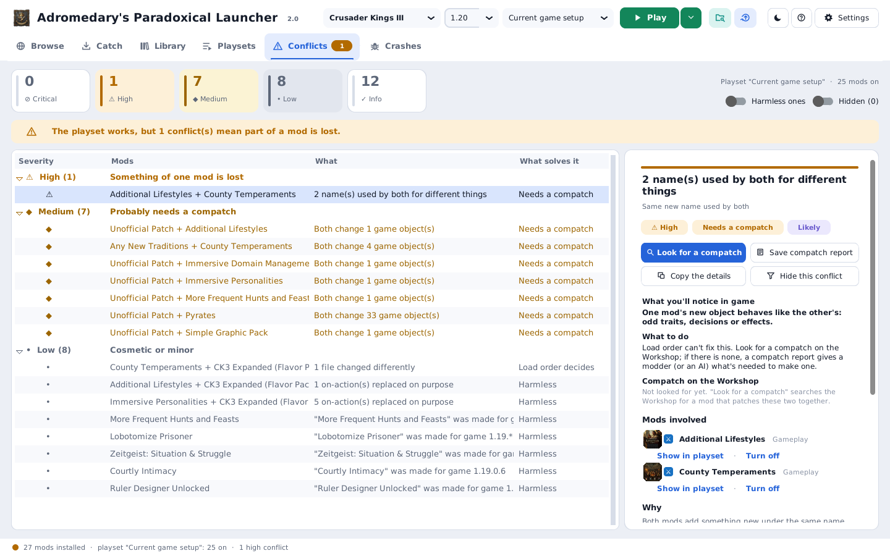
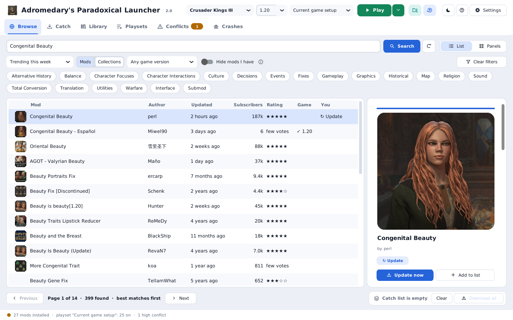
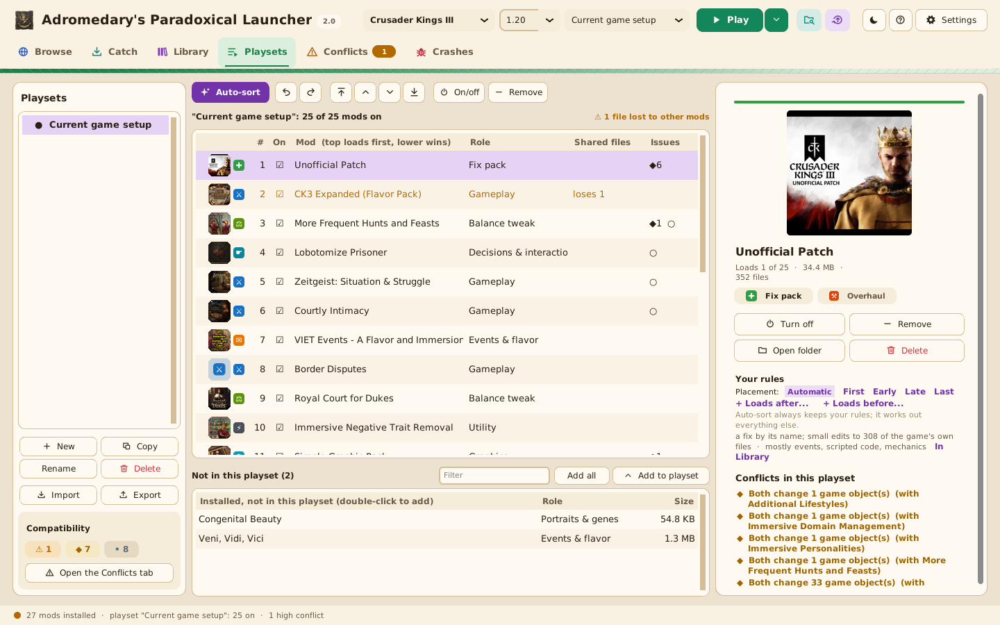
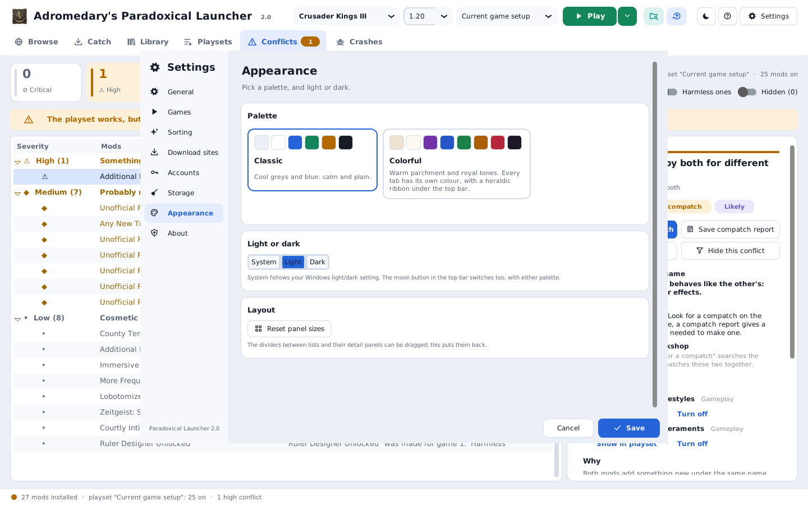
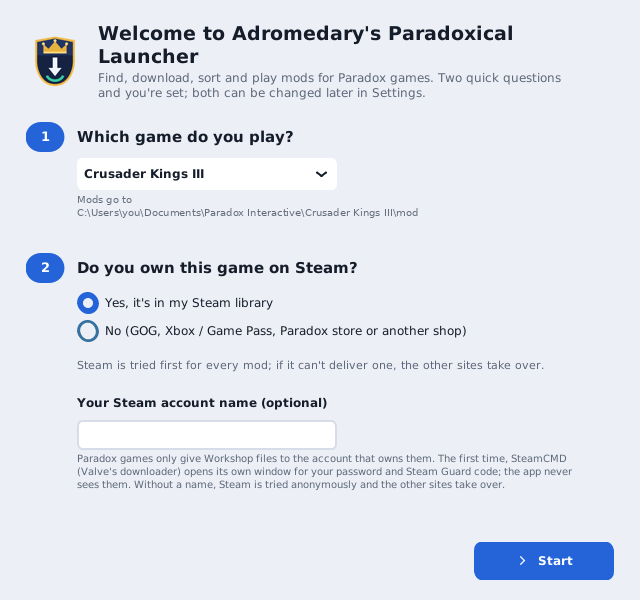

# Adromedary's Paradoxical Launcher

*Version 2.0.1 · by Adromedary*

A mod manager and launcher for Paradox games: **Crusader Kings III**, **Europa Universalis IV / V**,
**Stellaris**, **Hearts of Iron IV**, **Victoria 3** and **Imperator: Rome**.

Browse the Steam Workshop inside the app, download mods (even without owning the game on Steam),
see which ones clash and why, sort them into a working load order, and start the game with them.
No Paradox launcher needed.

## New in 2.0

* **Conflicts you can act on**: what you'll notice in game, what solves it and how sure the app is;
  new checks for defines, interface pieces and objects a mod leaves out; compatches you have are
  recognised, others searched for on the Workshop; a **compatch report** with a ready AI prompt.
* **Auto-sort 2**: says how sure it is of every move, puts compatches after both mods they patch, fix
  packs on top and interface mods near the bottom, optionally older-version mods first.
* **Playset rules** (First, Early, Late, Last, before / after a mod), a playset filter in Library, and
  roles you can see the reasons for and change.
* Ranked Workshop search, every screenshot in an in-app viewer, a kept catch list with retries, a
  dependency prompt, right-click menus everywhere, a storage limit for cached files.
* A **Crashes** tab: after a crash it names the mods most likely to blame with the evidence (errors traced
  to each mod's files, renamed or missing things, conflicts), compares every crash with the games that
  worked, and finds the culprit step by step.
* Redesigned **Settings**, and a new **Colorful** palette.

Full list: [CHANGELOG.md](CHANGELOG.md).

## What it does

| Tab | |
|---|---|
| **Browse** | Your game's Steam Workshop: search, sort (trending, popular, top rated, newest, recently updated), category filters (must have / hide), game-version fit, mods or collections. A list or big picture panels. Each mod shows its pictures, description, the mods it needs and whether you already have it. Catch one with a double-click; it downloads while you keep browsing. |
| **Catch** | Downloads mods and whole collections through a chain of sites (Steam, SkyMods, mod.io, Thunderstore, ModDB, GitHub, steamworkshop.download) and installs them into the game's mod folder. Pause and resume, even across restarts. Mods caught during a run start right after it. |
| **Library** | Every installed mod with its picture, a role badge (fix pack, overhaul, map, events, interface... 20 kinds), shared files, version notes and Workshop updates. |
| **Playsets** | Named mod lists in load order. Drag to reorder, undo / redo, your own "load after" rules, and **Auto-sort**, which works out the best order from the mods' files, what they use from each other and their Workshop pages, saying how sure it is of every move. |
| **Conflicts** | Everything that can go wrong in the active playset, from "these don't work together" to harmless, each explained with what happens in game and what solves it. Finds compatches on the Workshop and writes compatch reports. |
| **Crashes** | After a crash: what the game was doing, the mods most likely to blame (Likely / Possible, each with its evidence from the error log, conflicts, versions and your crash history: mods that were in a game that worked are cleared), a step-by-step culprit hunt on a copy of your playset, and crash reports for an AI chat or mod authors. |
| **Play** | Writes the playset into the game's load file and starts the game the way the Paradox launcher does. |

Two palettes, each in light and dark: **Classic** (cool greys and blue) and **Colorful** (warm
parchment and royal tones, every tab in its own colour, a heraldic ribbon under the top bar).

| | |
|---|---|
|  |  |
|  |  |
|  |  |

## Getting started

1. Download `ParadoxicalLauncher.exe` (Windows) or `ParadoxicalLauncher` (Linux) from the Releases page
   (or build it, see below) and put it in a folder of its own. It keeps its settings and downloads next
   to itself.
2. Start it. It asks two things: which game you play, and whether you own it on Steam. (Steam only
   hands out Workshop files to owners; if you don't own the game there, Steam is skipped and the
   other sites are used.)
3. Find mods in **Browse**, press **Catch now**, sort them in **Playsets**, check **Conflicts**,
   press **Play**.

The **?** button explains every part of the app, starting with a step-by-step "Start here".
Buttons that only show an icon explain themselves when you rest the pointer on them.

A short loading screen opens the app: it reads your mods, checks them, prepares their pictures and
draws every list, so the window opens ready to use. The check is kept on disk: while your mods don't
change, later starts take a couple of seconds.

## How it works

### Downloading
Each mod is tried on every enabled site in order until one delivers it:

| # | Site | How it finds the mod |
|---|------|----------------------|
| 1 | **Steam** (SteamCMD) | The official source. Paradox games only serve Workshop files to accounts that own the game. Skipped for games you don't own there. |
| 2 | **SkyMods** | Exact Workshop ID. |
| 3 | **mod.io** | Game and mod name. Needs a free API key. |
| 4 | **Thunderstore** | Game and mod name. |
| 5 | **ModDB** | Game and mod name, newest file. |
| 6 | **GitHub Releases** | Repository name plus game. |
| 7 | **steamworkshop.download** | Exact Workshop ID; only copies it cached earlier. |

Settings switches sites off or reorders them. Mods are matched to the game by Steam's app ID, and
installed as `mod\<id>\` plus `mod\<id>.mod`, whatever shape the download came in. Mods that are
already there (also copies Steam installed) are skipped. Partial downloads resume with HTTP range
requests; the queue survives closing the app.

SkyMods' file host shows a Cloudflare "verify you are human" check on downloads. With the check
window on, the page opens in a small browser window: if the check passes by itself nothing is shown,
otherwise the window appears and **you** tick the box. The app never ticks it for you.

### Analysis
After each scan every mod is read once in the background and compared with the game's own files
(when the install folder is known): which files it overrides and how much it changes in each, which
names it defines and uses, its texts, events and on-actions. From that come:

* **Roles**: what kind of mod it is, from what its files actually do.
* **Conflicts**, by severity: critical (declared incompatible, two total conversions, a missing
  dependency, the same mod twice), high (duplicate event IDs, overwritten on-action effects, the same
  new name used for different things, two mods replacing one window), medium (both change the same
  objects, defines or interface pieces in differently named files: only a compatch keeps both), low
  and info. Each says what you'll notice in game, what solves it and how sure it is. Compatches you
  have are recognised; others can be searched for on the Workshop, and a **compatch report** (Markdown,
  with both mods' versions side by side and a ready prompt for an AI chat) helps you make one.
* **Auto-sort**: a weighted ordering of your rules, declared dependencies, compatch / add-on names,
  "load after X" notes on Workshop pages, merged files, mods building on others, and the real cost of
  each shared-file clash; recognised compatches after both mods they patch; fix packs near the top and
  interface mods near the bottom; optionally mods for older game versions first. Mods that share
  nothing keep your order. You see a preview with the reason for every move, and how sure it is,
  before anything changes.

### Play
The playset's mods go, in order, into `Documents\Paradox Interactive\<game>\dlc_load.json`
(`content_load.json` for Victoria 3 and EU V), DLC settings untouched, with a backup in
`.work\backups`. The game is started with the arguments from its `launcher-settings.json`. The
install folder is found through Steam and GOG, or set in Settings > Games.

## Files next to the app

| | |
|---|---|
| `settings.json` | your choices |
| `profiles.json` | your playsets |
| `installed.json` | what was installed from where |
| `updates.json` | the last update check |
| `not_found.txt` | mods no site had, with each site's reason |
| `catch_list.json` | your catch list |
| `crash_history.json` | every crash and every game that worked, with their mods (for the Crashes tab) |
| `steamcmd\` | Valve's downloader |
| `.work\` | the resume queue and partial downloads, backups, cached Workshop pages, pictures and screenshots (cleared when they pass your limit, Settings > Storage), the game's definitions (once per version), `errors.log` |

## Build

**Windows**: Python 3.10 or newer ("Add python.exe to PATH" ticked). Double-click **`build.bat`**.
The result is `dist\ParadoxicalLauncher.exe`.

**Linux**: Python 3.10 or newer with Tk and venv (Debian/Ubuntu: `sudo apt install python3 python3-venv
python3-tk`; Fedora: `sudo dnf install python3 python3-tkinter`; Arch: `sudo pacman -S python tk`).
Run **`./build_linux.sh`**. The result is `dist/ParadoxicalLauncher`; `./install_desktop_entry.sh
dist/ParadoxicalLauncher` adds it to your applications menu.

## Run from source

    pip install -r requirements.txt
    pip install pywebview            (optional: the "verify you are human" window)
    python paradoxical_launcher.py

On Linux, `./run_linux.sh` does all of that in a private environment (`.venv`) on first run.

## Linux

* Game folders: `~/.local/share/Paradox Interactive/<game>` for the native games, `~/Documents/Paradox
  Interactive/<game>`, and the Documents folder inside a game's Proton prefix (a Windows copy run through
  Steam Play). The app looks in all of them.
* Steam is found in `~/.steam/steam`, `~/.local/share/Steam`, and the Flatpak and Snap folders, with every
  library in `libraryfolders.vdf`.
* Play starts a native copy directly, the way the Paradox launcher does; a Windows copy under Proton is
  started through Steam (`steam -applaunch`), with the mod list already written for it.
* `.rar` / `.7z` downloads need `bsdtar` (libarchive-tools), `7z` or `unrar` installed.
* The "verify you are human" window needs pywebview with GTK WebKit or Qt WebEngine; without it, sites
  that show that check are skipped.

## Code map

| File | |
|---|---|
| `paradoxical_launcher.py` | main window, settings, help, What's new, welcome, event loop |
| `gui_browse.py`, `gui_catch.py`, `gui_library.py`, `gui_playsets.py`, `gui_conflicts.py`, `gui_crash.py` | the tabs |
| `gui_common.py`, `gui_viewer.py`, `glyphs.py`, `icons.py`, `cards.py`, `appicon.py` | look: the two palettes, shared widgets (tabs, detail panels, dividers, tips, right-click menus), the picture viewer, drawn icons, pictures, Browse cards, app icon |
| `workshop.py` | reading the Steam Workshop (browse pages, item details) |
| `engine.py`, `sources.py`, `net.py`, `installer.py`, `browser_helper.py` | downloading and installing |
| `modscan.py`, `script.py`, `analysis.py`, `roles.py`, `loadorder.py` | reading mods, conflicts, roles, Auto-sort |
| `compat.py`, `report.py` | finding compatches on the Workshop, compatch reports |
| `crash.py` | crash analysis: reading crash folders and logs, suspects, the culprit hunt, crash reports |
| `launcher.py`, `profiles.py`, `updates.py`, `versions.py`, `storage.py` | games, playsets, updates, versions, cached-file clean-up |
| `help_text.py` | the Help window's text |

## Notes

* Developed and tested with **Crusader Kings III**. The other games use the same mod layout and should
  work; Victoria 3 and Europa Universalis V also describe mods in a newer `metadata.json` file, which
  the app doesn't read yet.
* SkyMods and steamworkshop.download re-host Workshop content without the creators' involvement;
  using them may conflict with Steam's terms. They can be switched off in Settings.
* Nexus Mods can't be automated (it blocks automated access; its download API needs Premium).
* If Steam changes its Workshop page, Browse may stop working until the app is updated; Catch keeps
  working with links.
